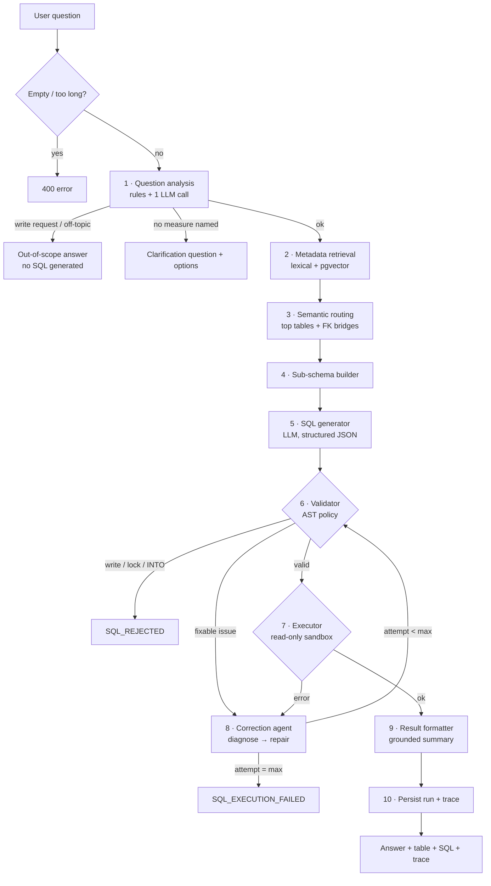

# AI pipeline

One central service, `processQuestion({ question, datasetId })` in `src/lib/nl2sql/orchestrator.ts`, owns an explicit
`QueryExecutionState` and calls small, independently testable stages in order. It first **resolves the dataset** (ownership and
status checked; `DATASET_NOT_FOUND` / `DATASET_NOT_READY` otherwise) into a `DatasetContext`, and every stage below then works from that
dataset's metadata registry — the pipeline is generic and contains no table names. The built-in demo is the dataset `demo`.



## State

```ts
interface QueryExecutionState {
  question: string;
  dataset?: { id: string; name: string };   // the dataset every stage runs against
  intent?: QuestionIntent;          // scope, ambiguity, concepts, assumptions
  routing?: RoutingResult;          // scored items, selected tables, bridges, matched metrics
  subSchema?: SubSchema;            // the reduced schema given to the LLM
  generated?: GeneratedSql;         // sql, explanation, tables_used, assumptions
  currentSql?: string;
  validation?: ValidationResult;
  execution?: ExecutionResult;
  correctionAttempts: CorrectionAttempt[];
  attempts: number;
  formatted?: FormattedResult;
  trace: AgentTrace;                // everything above + LLM calls + per-stage timings
}
```

## Stages

### 1 · Question analysis (`question-analyzer.ts`, prompt `prompts/question-analysis.ts`)

Deterministic rules run first (free, and cannot be prompt-injected):

* empty / > 500 chars → error;
* write requests (“delete all customers”), pasted SQL, or a write command embedded anywhere in the text
  (“…; also drop table products”) → `out_of_scope` with a read-only message;
* unmistakably off-topic words (weather, poem, recipe, …) → `out_of_scope`, and so is any question with no reference to
  the domain vocabulary and no data-question pattern (“What's the weather today?”);
* a question made only of vague words (“What were the sales?”, “How are we doing?”) → `needs_clarification` with three options.

Only if the rules say “proceed” is **one structured LLM call** made to classify scope/ambiguity and to extract
`concepts` and `search_terms` (synonym expansion) that feed retrieval. The model does not get the last word: its answer
must validate against a Zod schema, and **strong lexical evidence overrules a wrong verdict** — if the question uses two or
more distinct registry terms, a model “out of scope” is overridden, and a clarification request is dropped when a known
business measure or such evidence is present (a real free model did both on ordinary questions during evaluation; the
override is recorded as an assumption in the trace). `ANALYSIS_MODE=rules` skips the call entirely.

Ambiguity policy: ask when the missing information changes the result and no documented default applies; otherwise
apply the documented default (listed in the registry `defaults` and shown to the SQL generator) and record it as an
assumption. Example defaults: *revenue = online completed orders*, *last month = previous full calendar month*, *top N
without N = 10*.

### Datasets and defaults

Documented defaults are data (`always` / `whenTables` / `whenMetrics` rules in the registry), not code: the demo keeps its curated ones
(revenue scope, category, geography, …); uploaded datasets get four generic ones (relative dates, ranking, rounding, counting) and no
business metrics. Because uploaded datasets have no metrics to pull the right tables in, routing additionally includes a table that holds a
strongly matching *column* when the dataset defines no metrics. Refusal messages, clarification options and the analysis prompt are built
from the dataset (its description and table names), so "What's the weather?" against an HR dataset is refused with HR topics.

### 2 · Metadata retrieval (`metadata-retriever.ts`, `metadata/lexical.ts`, `metadata/embeddings.ts`)

> Terminology: this is **hybrid metadata retrieval and schema routing** — it retrieves *schema metadata* to decide which tables the SQL generator sees. It is not
> document RAG, and no claim of "semantic RAG accuracy" is made: the vector half is optional, is off unless an embedding model is configured, and has **not been evaluated**
> (no embedding provider was available; all measured routing numbers are lexical-only). The pgvector path is covered by plumbing tests with a deterministic hashing embedder.

The registry is flattened into **items**: one per table (description, synonyms, column list), per column
(description, business meaning, synonyms, sample values) and per business metric (definition, synonyms) — ~180 items.

* **Lexical**: in-process BM25-flavoured scorer. IDF weighting, extra weight for name/synonym hits, a light stemmer
  (orders → order, ordered → order), multi-word phrase matches (“average order value”), loose phrase matches
  (“percentage of orders were refunded” ≈ “refund rate”), and an “explicit table mention” floor (a table named in the
  question is always a candidate). Scores are normalised per kind with a floor so one weak hit is not inflated to 1.0.
* **Vector (optional)**: the question (+ analyzer concepts) is embedded and matched against
  `nl2sql.metadata_embeddings` with pgvector cosine distance (HNSW index), **filtered by `dataset_id`** (primary key `(dataset_id, item_id)`). Similarities are min-max normalised.
* **Hybrid**: `score = 0.55·lexical + 0.45·vector`. If `EMBEDDING_MODEL` is unset, no embeddings are stored, or the
  embedding API fails, retrieval **degrades to lexical only** and the trace records why
  (`vectorUnavailableReason`). The app never requires embeddings.

### 3 · Semantic routing (`router.ts`)

Item scores → table scores (table item + 0.35 × top-3 column hits + 0.7 × matched-metric boost). Tables are selected
relative to the best score (≥ 40 % of the top and ≥ 0.25, max 5); the tables a matched business metric needs
(revenue → `orders`, `order_items`) are added. **Relationship expansion** then connects every selected table to the
growing component through the foreign-key graph (BFS shortest path), adding at most two *bridge* tables per join
(e.g. `product_categories → products → order_items → orders` adds `products`).

### 4 · Sub-schema builder (`sub-schema-builder.ts`)

Produces exactly what the SQL generator sees: the selected + bridge tables; only the relevant columns (primary keys,
join keys between included tables, registry-flagged `core` columns, columns needed by matched metrics, columns with
retrieval score ≥ 0.3; **bridge tables contribute keys only**); only the foreign-key relationships whose both ends are
included; the matched business definitions; and the relevant documented defaults. On the benchmark the sub-schema
averages **2.7 tables out of 20**.

### 5 · SQL generator (`ai/sql-generator.ts`, `prompts/sql-generation.ts`)

Names that need quoting (reserved words, mixed case — possible in uploaded schemas) are shown quoted in the schema, with a note to keep the quotes.
Prompt = role + SQL rules (dialect, single read-only statement, only listed tables/columns, aliases, no comments, safe
division, time attribution — use the date column of the table whose rows are counted, not one borrowed from a related table, …) + today's date + the rendered sub-schema + the question in `<question>` tags. The model must return JSON
`{sql, explanation, tables_used, assumptions}`, validated with Zod; on a schema violation the provider does **one repair
round-trip** (the model sees its own output and the validation errors). SQL is never executed straight from model text —
it goes to stage 6.

### 6 · Validator — see [SECURITY.md](SECURITY.md)

Its table allow-list, column check and permitted schema come from the selected dataset's registry.

### 7 · Executor (`database/executor.ts`)

Read-only role, `READ ONLY` transaction, statement timeout, pinned `search_path`, cursor-based row cap. Returns
`{success, columns, rows, rowCount, truncated, executionTimeMs}` or `{success:false, error:{code, category, message, detail}}`.
`message` is user-safe; `detail` is the sanitised database message used by the correction agent.

### 8 · Self-correction (`ai/correction-agent.ts`, `prompts/sql-correction.ts`)

Bounded by `MAX_SQL_ATTEMPTS` (default **3 SQL attempts = 1 generation + up to 2 corrections**). Triggered by:

* a **validator** rejection that is fixable (unknown table/column, forbidden function/schema, comment, parse error,
  multiple statements, …), or
* a **database** error (syntax, missing column, type mismatch, division by zero, timeout, …).

The agent receives the question, the failed SQL, the stage, the exact error, the sub-schema and all earlier failed
attempts, and **must diagnose first** (`diagnosis` field) before returning a minimal repair. The result goes through the
same validator and executor. Never retried: write/locking/`INTO` attempts (`SQL_REJECTED` immediately), connection
failures (`DATABASE_UNAVAILABLE`), and a correction that repeats an SQL that already failed. Every attempt records
`{attempt, failedSql, failureStage, error, diagnosis, correctedSql, outcome}` and appears in the UI trace.

### 9 · Result formatter (`ai/result-formatter.ts`, `prompts/result-interpretation.ts`)

* 0 rows → exactly **“No matching records were found.”** (no model call).
* Otherwise a deterministic summary is always built from the rows; if `SUMMARY_MODE=llm` a model writes a nicer one
  from at most 25 rows — **for the built-in synthetic demo only**. For an uploaded dataset the summary is always the deterministic
  one, so result rows of user data are never sent to a model (a unit test asserts this). A **grounding check** then verifies that every number in the model text appears in the data
  (allowing for rounding/formatting), is the row count, or is a small ordinal. Any invented figure → the
  deterministic summary is used and the call is marked `fallback` in the trace. A failing summary call never fails the
  request.

### 10 · Trace & persistence

`AgentTrace` records: question, intent, routing (scores, method, reason vector search was skipped), sub-schema, every
SQL attempt with validation issues and execution outcome, corrections, every LLM call (purpose, model, latency, ok),
per-stage timings, provider/model and the final answer. It is returned to the UI and stored in
`nl2sql.query_runs.trace` (without result rows). History is scoped by an anonymous session cookie.

## Prompts

All in `src/lib/ai/prompts/`: `question-analysis.ts`, `sql-generation.ts`, `sql-correction.ts`,
`result-interpretation.ts`, plus shared `common.ts` (dialect, SQL rules, injection guard, sub-schema renderer). Each
states role, allowed tables (through the rendered schema), allowed operations, dialect, output format and
anti-hallucination rules. There is **no separate LLM “routing” prompt**: routing is deterministic (lexical + vector +
graph expansion) — see [DECISIONS.md](DECISIONS.md).

## Provider abstraction (`ai/provider.ts`)

```ts
interface AIProvider {
  generate(req): Promise<{ text; latencyMs }>;
  generateStructured<T>(req & { schema: ZodType<T> }): Promise<{ data: T; raw; latencyMs; attempts }>;
  embed(texts: string[]): Promise<number[][]>;
  canEmbed(): boolean;
}
```

The only implementation, `OpenAICompatibleProvider`, speaks the OpenAI chat/embeddings HTTP API with `fetch` (no SDK),
which covers OpenRouter (including `:free` models), Groq, Google Gemini's OpenAI-compatible endpoint, Ollama (local),
OpenAI and any other compatible server. Selection is by env vars only (`AI_PROVIDER`, `AI_MODEL`, `AI_API_KEY`,
`AI_BASE_URL`). Features: JSON-mode with automatic fallback when the provider rejects `response_format`; extraction of
JSON from fenced/prose/`<think>` output; Zod validation with one repair round-trip; one retry on 429/5xx/timeouts;
typed errors (`PROVIDER_NOT_CONFIGURED | AUTH | RATE_LIMIT | UNAVAILABLE | BAD_OUTPUT`) mapped to user-facing messages;
embedding dimension validation against the `vector(768)` column.

## Error → user message map

| Situation | Code | What the user sees |
|-----------|------|--------------------|
| Empty / too long | `EMPTY_QUESTION`, `QUESTION_TOO_LONG` | Prompt to fix the input (HTTP 400) |
| Off-topic / write request | `out_of_scope` status | “outside the available database domain…” / read-only message |
| Ambiguous | `needs_clarification` status | Question + clickable options |
| Invalid model JSON (after repair) | `PROVIDER_BAD_OUTPUT` | AI provider problem |
| Hallucinated table/column, bad function | validator issue → correction | Shown in the trace; corrected automatically |
| DB syntax/column/table/type error, timeout | correction loop → `SQL_EXECUTION_FAILED` | Friendly message + what the agent tried |
| Write attempt | `SQL_REJECTED` | “blocked by the safety validator” |
| Missing/invalid key, rate limit, model unavailable | `PROVIDER_NOT_CONFIGURED/AUTH/RATE_LIMIT/UNAVAILABLE` | Specific guidance (HTTP 503/502/429) |
| DB unreachable | `DATABASE_UNAVAILABLE` | “temporarily unavailable” (no internals) |
| Too many requests | `RATE_LIMITED` | Wait a minute (HTTP 429) |
