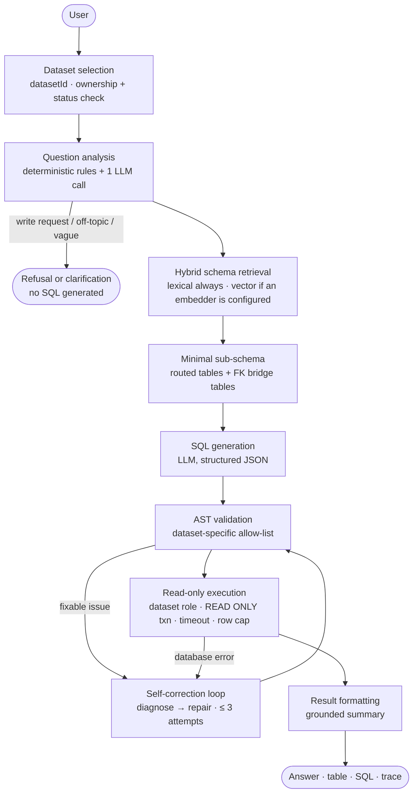
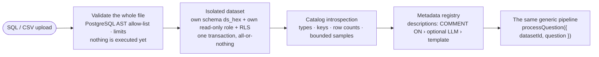
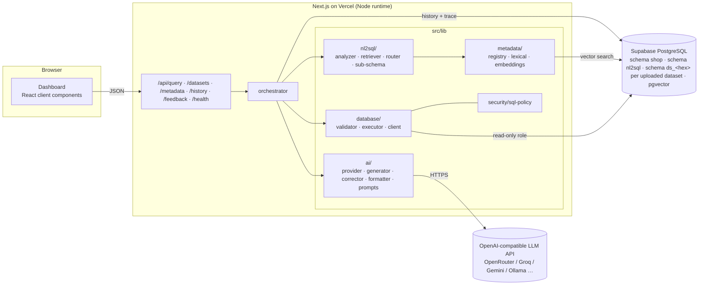

# Architecture

A **modular monolith**: one Next.js application (App Router, TypeScript) whose route handlers call plain TypeScript
modules under `src/lib`. There is no separate backend, queue or worker. Every module is framework-independent
(no `next/*` imports below `src/lib/http.ts`), so the pipeline could be lifted into a FastAPI service later.

## The two paths through the system

**Asking a question** — every stage receives the selected dataset explicitly; nothing has a global "current dataset".



**Adding data** — uploads are untrusted; the metadata is read back from the real database catalog, not from what the file claims.



## Component view



## Repository layout

```
src/
  app/                    Next.js App Router
    page.tsx              dashboard (client components below)
    api/query|metadata|history|history/[id]|feedback|health/route.ts
    api/datasets/(route|upload|[id]|[id]/activate|[id]/relationships)  dataset management
    datasets/ , datasets/new , datasets/[id]     dataset UI pages
  components/             dashboard, query-input, result-table, sql-viewer, execution-trace, charts, sidebar, ui/
  lib/
    config.ts             validated env configuration (zod)
    types/                shared domain types
    ai/                   provider.ts, sql-generator.ts, correction-agent.ts, result-formatter.ts, prompts/
    nl2sql/               question-analyzer, metadata-retriever, router, sub-schema-builder, orchestrator, text
    datasets/             DatasetContext, import (sql-import, csv-import, import-service), introspect, metadata-builder, store, limits
    metadata/             definitions.ts (the demo's curated data), registry.ts (index builder), lexical.ts, embeddings.ts
    database/             client.ts (pools), validator.ts, executor.ts, errors.ts
    security/sql-policy.ts  allow-lists and limits
    history/store.ts      query_runs, feedback, rate limit
    http.ts               cookies / client hash / status mapping (the only next/* importer in lib)
supabase/
  migrations/             5 SQL migrations (extensions, 20 tables, app tables, role + RLS, datasets)
  seed/generate.ts        deterministic data generator
scripts/                  db.ts (migrate/seed/reset/status), embed-metadata.ts, eval.ts (development benchmark), eval-heldout.ts (held-out benchmark)
tests/                    unit/ integration/ evaluation/ (benchmark, heldout/ fixtures + questions + upload corpus, results/) helpers/
docs/                     this documentation
```

## Request lifecycle (`POST /api/query`)

1. Parse body (`{question, datasetId}`); verify `DATABASE_URL` is configured.
2. Read/create the anonymous session cookie; hash the client IP; DB-backed rate limit check.
3. `processQuestion({ question, datasetId })` — resolves the dataset (ownership + status check) into a `DatasetContext`, then runs the
   pipeline in [AI_PIPELINE.md](AI_PIPELINE.md) against exactly that dataset.
4. The run and its trace are persisted (a persistence failure never fails the request).
5. JSON response: `{success, status, answer, keyPoints, sql, explanation, tablesUsed, columnsUsed, columns, rows,
   rowCount, truncated, executionTimeMs, totalLatencyMs, attempts, corrections, clarification?, error?, trace, runId}`.
   HTTP status mirrors the outcome (200 answered / out-of-scope / clarification, 400 bad input, 422 unsafe or
   unfixable SQL, 429 rate limits, 502/503 provider or database problems).

Other endpoints: `/api/datasets/*` (upload, list, details, delete, activate, confirm relationships), `GET /api/metadata?datasetId=` (tables, columns, relationships, metrics), `GET /api/history` and
`GET /api/history/[id]` (this session's runs and full traces), `POST /api/feedback` (thumbs), `GET /api/health`
(setup diagnostics: booleans only).

## Datasets: one generic engine, many metadata registries

The NL2SQL engine contains no table names. Everything it needs about a dataset is in a `DatasetContext`
(`src/lib/datasets/context.ts`): the PostgreSQL schema, the read-only role to run as, the metadata registry, and the derived
indexes (lexical index, FK graph). The built-in e-commerce demo is just the context with id `demo` (schema `shop`, curated
registry in code); an uploaded dataset is a context loaded from `nl2sql.datasets` (schema `ds_<hex>`, registry generated from the
database catalog). Retrieval, routing, sub-schema building, prompts, the SQL validator, the executor, embeddings and history all take the
context (or its id) explicitly — there is no global "current dataset". See [DATASET_UPLOAD.md](DATASET_UPLOAD.md).

## Design principles

* **Metadata is data.** `definitions.ts` is the single source of truth for descriptions, synonyms, sample values,
  business metrics and defaults; relationships are *derived* from foreign-key declarations. An integration test compares
  it to the live database so it cannot drift.
* **Deterministic where it matters.** Scope rules, routing, sub-schema construction, validation, execution limits and
  grounding checks are code. The LLM is used for the three things it is good at: understanding the question, writing
  SQL, and phrasing the answer.
* **Stages are functions over explicit state**, each independently testable (`stageAnalyze`, `stageRoute`,
  `stageBuildSubSchema`, `stageGenerate`, `stageExecuteWithCorrection`, `stageFormat`).
* **Graceful degradation.** No embeddings → lexical retrieval. Summary model fails → deterministic summary.
  History store fails → the answer is still returned. Provider not configured → clear setup banner.
* **Serverless-friendly.** No filesystem writes, no in-process state that matters (rate limiting and history live in
  Postgres), small pools (`max: 3`), `libpg-query`/`pg` kept external to the bundle, `maxDuration = 60` on the query route.
