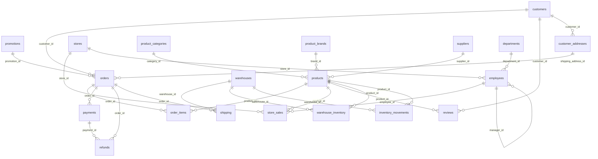

# Database

The demo domain is an omnichannel retailer: online orders **and** physical stores, a product catalogue with
brands/suppliers, warehouse inventory, promotions, payments/refunds/shipping and customer reviews.
PostgreSQL 15+ (developed and tested on 16) with the `vector` extension.

## Schemas

| Schema | Purpose | Exposed to LLM-generated SQL? |
|--------|---------|-------------------------------|
| `shop` | The 20 demo tables users ask questions about | **Yes** — read-only, via role `nl2sql_readonly` |
| `nl2sql` | Application tables: `query_runs`, `feedback`, `metadata_embeddings`, `schema_migrations` | **No** — role has no privileges |

Neither schema is in Supabase's exposed API schemas (`public` only by default), and RLS is enabled on every table
(see [SECURITY.md](SECURITY.md)).

## Entity-relationship diagram (`shop`)

Generated from the metadata registry's foreign keys (`crow's foot`: parent `||--o{` child).

## Tables (20)

| Table | Area | Cols | Description |
|-------|------|------|-------------|
| `orders` | sales | 7 | Online customer purchase transactions (one row per order) |
| `order_items` | sales | 7 | Line items: product, quantity, price, discount, generated `line_total` |
| `payments` | sales | 6 | Payments against orders (method, amount, status) |
| `refunds` | sales | 6 | Full or partial refunds with a reason |
| `shipping` | sales | 9 | Shipment from a warehouse: carrier, cost, shipped/delivered timestamps |
| `promotions` | sales | 9 | Discount campaigns (each yearly occurrence is one row, e.g. `BLACKFRIDAY30-2025`) |
| `store_sales` | sales | 8 | In-store point-of-sale lines by store employees (separate from online orders) |
| `reviews` | sales | 7 | 1–5 star product reviews |
| `customers` | customers | 10 | Registered customers, loyalty segment, acquisition channel |
| `customer_addresses` | customers | 9 | Shipping/billing addresses (source of city/country) |
| `products` | catalogue | 12 | Catalogue with price, cost, category, brand, supplier |
| `product_categories` | catalogue | 3 | 12 flat categories |
| `product_brands` | catalogue | 3 | 24 brands |
| `suppliers` | catalogue | 7 | 15 suppliers with rating and lead time |
| `warehouses` | inventory | 5 | 5 distribution centres |
| `warehouse_inventory` | inventory | 5 | Stock per (warehouse, product) with `reorder_level` |
| `inventory_movements` | inventory | 6 | Restocks / sales / returns / adjustments |
| `stores` | organisation | 8 | 10 physical stores |
| `employees` | organisation | 11 | Head-office and store staff; self-referencing `manager_id` |
| `departments` | organisation | 3 | 8 departments |

Design notes:

* Integer identity keys (not UUIDs) keep results readable and the seed deterministic.
* Every table has a primary key; there are 26 foreign keys and secondary indexes on every FK and on the hot filter
  columns (`orders.order_date`, `orders.status`, `customers.signup_date`, `customer_addresses.city`, …).
* `order_items.line_total` and `store_sales.total_amount` are `GENERATED ALWAYS … STORED` columns.
* `orders.total_amount` = `SUM(order_items.line_total)` for the order (verified by an integration test), so order-level
  and line-level revenue always agree. Shipping cost lives in `shipping`, not in the order total.
* CHECK constraints encode the enumerations (`orders.status`, `payments.payment_method`, …).

### Business definitions used by the system

These live in the metadata registry (`src/lib/metadata/definitions.ts`) and are given to the SQL generator.

* **Completed order** = `orders.status IN ('shipped', 'delivered')`.
* **Revenue** = `SUM(order_items.line_total)` over completed orders, attributed by `orders.order_date`. In-store
  sales (`store_sales`) are only used when the question is about stores.
* **Refund rate** = distinct refunded orders / completed orders.
* **Low stock** = `warehouse_inventory.quantity_on_hand <= reorder_level`.
* **Relative dates** are computed from `CURRENT_DATE` (last month = previous full calendar month).

## Seed data

`supabase/seed/generate.ts` is a pure, deterministic generator (seeded PRNG). Default volumes:

| Table | Rows | Table | Rows |
|-------|-----:|-------|-----:|
| orders | ~11,000 | customers | 1,800 |
| order_items | ~22,000 | customer_addresses | ~3,100 |
| payments | ~10,700 | products | 240 |
| refunds | ~580 | reviews | ~3,700 |
| shipping | ~10,400 | store_sales | ~17,900 |
| inventory_movements | 12,000 | employees | 126 |

The data spans the 24 months ending at the **anchor date** (default: the day you seed, so “last month” always has
data; override with `SEED_ANCHOR_DATE=YYYY-MM-DD`). Given the same anchor date and seed the output is identical.
It contains deliberate analytical structure: seasonality (Nov/Dec peaks), business growth, per-category growth and
decline (Smartphones up, Books/Toys/Furniture down), heavy-tailed customer activity, promotions concentrated in their
campaign windows, ~5–6 % refunded orders, and ~16 % of stock rows below their reorder level. Total size is a few MB,
well inside the Supabase free tier.

## Commands

| Task | Command |
|------|---------|
| Apply pending migrations | `npm run db:migrate` |
| (Re)seed demo data | `npm run db:seed` |
| Drop everything and rebuild | `npm run db:reset` |
| Show migrations and row counts | `npm run db:status` |
| Embed the metadata registry (optional) | `npm run metadata:embed` |

`db:reset` drops schemas `shop`, `nl2sql` and every uploaded `ds_*` schema (CASCADE), and the `nl2sql_ro_*` roles, re-applies all migrations and re-seeds. It does not touch other
schemas or the cluster-level `nl2sql_readonly` role. Migrations use `SET LOCAL search_path … , extensions` (scoped to their own transaction) so they work whether pgvector lives in `public` (plain PostgreSQL) or in an `extensions` schema (Supabase). Migrations are tracked in `nl2sql.schema_migrations`; the same SQL
files in `supabase/migrations/` also work with `supabase db push`.

## Datasets (schema per dataset)

The 20 tables above are the **built-in demo dataset** (id `demo`). User-uploaded datasets (see [DATASET_UPLOAD.md](DATASET_UPLOAD.md)) each get
their own schema `ds_<10 hex>` and their own read-only role `nl2sql_ro_<10 hex>`; `nl2sql.datasets` is the registry of datasets
(status, counts, generated metadata, owner session). Query history and embeddings carry a `dataset_id` (migration 5). Uploaded schemas
are not exposed through the Supabase Data API and have RLS enabled, like `shop`.

## Application tables

* `nl2sql.query_runs` — one row per question: question, final SQL, tables/columns used, attempt count, status, error,
  answer, **row count only (no result rows)**, timings, provider/model and the full agent trace (`jsonb`).
* `nl2sql.feedback` — thumbs up/down per run.
* `nl2sql.metadata_embeddings` — one `vector(768)` per table/column/metric metadata item **per dataset** (`PRIMARY KEY (dataset_id, item_id)`)
  with an HNSW cosine index (`content_hash` makes re-embedding incremental).
* `nl2sql.datasets` — dataset registry: `id`, `name`, `source_type` (builtin/sql/csv), `status` (processing/ready/failed/deleted),
  `schema_name`, `role_name`, `session_id` (owner), counts, generated `metadata` (jsonb), unconfirmed `suggested_relationships`, `embedding_status`.
* `nl2sql.query_runs.dataset_id` — which dataset each question ran against.
