# User-provided datasets (SQL / CSV upload)

> User-provided SQL/CSV datasets are imported into isolated PostgreSQL environments and exposed to the generic NL2SQL pipeline.

This is **not** general database support. It is a demo feature for small, synthetic datasets: you upload a `.sql` file or a
few `.csv` files, the app imports them into their own schema, builds a metadata registry from the *real* catalog, and the same
pipeline that serves the built-in e-commerce demo answers questions about them.

```mermaid
flowchart LR
    U[Upload .sql / .csv] --> P[Parse + validate<br/>allow-list, limits<br/>nothing executed yet]
    P --> S[Create schema ds_&lt;hex&gt;<br/>+ read-only role<br/>one transaction]
    S --> I[Introspect real catalog<br/>tables · columns · keys · row counts · samples]
    I --> M[Metadata registry<br/>same format as the demo]
    M --> E[Optional embeddings<br/>dataset_id-scoped]
    E --> R[Ready]
    R --> Q[Generic NL2SQL pipeline<br/>processQuestion&#40;&#123;datasetId, question&#125;&#41;]
```

## Supported input

### `.sql` (exactly one file per dataset)

The whole file is parsed with PostgreSQL's own parser (libpg-query) and every statement is checked against an allow-list
**before anything is executed**. If any statement is unsupported the entire file is rejected with
*"This SQL file contains unsupported statements."* plus the offending line numbers; nothing is partially executed.

| Supported | Notes |
|-----------|-------|
| `CREATE TABLE` | columns, `PRIMARY KEY`, `UNIQUE`, `NOT NULL`, `CHECK`, `DEFAULT` (constants / allow-listed functions), `REFERENCES` (inline or table-level), `SERIAL` / `GENERATED … AS IDENTITY` |
| `ALTER TABLE … ADD CONSTRAINT` | `PRIMARY KEY`, `UNIQUE`, `FOREIGN KEY`, `CHECK`; also `SET DEFAULT`, `SET NOT NULL` |
| `CREATE INDEX` | btree on plain columns (no `CONCURRENTLY`: the import is one transaction) |
| `INSERT INTO … VALUES (…)` | literal values only (no sub-selects, no `ON CONFLICT`, no `RETURNING`) |
| Table names | must not start with `pg_` / be `information_schema` (system-catalog names; would shadow `pg_catalog`). CSV file names that start with `pg_` are prefixed `t_` |
| `COMMENT ON TABLE / COLUMN` | become descriptions (source: *database*) |
| `BEGIN` / `COMMIT`, `SET client_encoding`-style lines, `ALTER … OWNER TO`, `CREATE SCHEMA IF NOT EXISTS public` | ignored, reported as notes |
| `public.` prefixes | removed with an AST-guided, byte-exact rewrite (any other schema qualifier is rejected) |

Column types: `integer/bigint/smallint`, `numeric/decimal`, `real/double precision`, `text/varchar/char`, `boolean`,
`date/time/timestamp[tz]/interval`, `uuid`, `json/jsonb`, `serial` variants. Arrays, `bytea`, enums and custom types are rejected.

**Rejected** (each reported with its line): `DROP …`, `CREATE/DROP DATABASE`, `GRANT/REVOKE`, `CREATE/ALTER/DROP ROLE`,
`CREATE EXTENSION`, foreign data wrappers / `CREATE SERVER`, **`COPY`** (including `COPY … PROGRAM` and server-side files —
use `INSERT` statements instead), `DO` blocks, functions/procedures/triggers/views/sequences/types, `SELECT`/`UPDATE`/`DELETE`/`TRUNCATE`,
`CREATE TABLE AS`, temp/unlogged/partitioned/inherited tables, `SET` of anything but harmless encoding-style settings,
any reference to another schema (`nl2sql.*`, `other.*`, `db.public.*`), sub-queries or non-allow-listed functions in defaults/`CHECK`/`VALUES`.

### `.csv` (1–10 files → one table per file)

* RFC 4180 parser (quotes, doubled quotes, embedded newlines, CRLF/LF, BOM); delimiter auto-detected (`,` `;` tab `|`).
* First row is the header. Table names come from file names, column names from headers, both normalised to safe
  `lower_snake_case` identifiers and de-duplicated.
* **Conservative type inference** — a column gets `integer`/`bigint`/`numeric`/`boolean`/`date`/`timestamp[tz]` only if *every*
  non-empty value fits; otherwise `text`. Values with leading zeros (zip codes, `007`) stay text; impossible dates stay text.
* Empty cells are `NULL`. A row whose field count differs from the header rejects the file with the line numbers.
* Empty files, files without a header, binary content and unterminated quotes are rejected.
* **Relationships are never assumed.** CSV has no constraints, so the importer only *suggests* a relationship for a column
  named `<x>_id` when a table named like `<x>` has a unique, never-null key **and every non-null value of the column exists in it**
  (verified with a query). Suggestions are shown with their evidence and are **not part of the metadata** until you confirm them;
  confirmed ones become real `FOREIGN KEY` constraints (the target column becomes a `PRIMARY KEY`/`UNIQUE` key). SQL uploads
  need no confirmation: their relationships come from the real constraints in the file.

## Limits (demo-sized on purpose)

| Limit | Value | Why |
|-------|------:|-----|
| Whole upload | 4 MB | Vercel serverless request bodies are capped at 4.5 MB |
| `.sql` file | 4 MB | |
| CSV file | 2 MB each | |
| Files per upload | 10 | |
| Tables / dataset | 30 | |
| Columns / table · total | 60 · 400 | |
| Rows (all tables) | 50,000 (`DATASET_MAX_ROWS`) | import runs inside one 60 s function |
| Import time budget | 45 s | `statement_timeout` on the import transaction |
| Datasets per browser session | 5 | storage hygiene |
| Uploads per client per hour | 6 | abuse control |
| Lifetime | 72 h (`DATASET_TTL_HOURS`) | uploaded data is deleted automatically |

Do not use this to load production databases.

## Import process

`POST /api/datasets/upload` (multipart) streams newline-delimited JSON so the UI shows real progress:

1. **Parse** — validate the whole upload (types, size, allow-list); *no execution*.
2. **Detect tables / columns** — counts from the parsed plan.
3. **Load** — one transaction (`REPEATABLE READ`, 45 s timeout): `CREATE SCHEMA ds_<hex>`, `SET LOCAL search_path` pinned to it,
   run the validated statements (INSERTs batched, structure statements one by one), re-apply `COMMENT`s, create the dataset's
   read-only role, grants, and Row Level Security. A *tripwire* compares relation counts outside the schema before/after and
   aborts if the import created anything elsewhere. **Any failure rolls back everything.**
4. **Detect relationships** — read foreign keys from `pg_constraint` (SQL) or compute verified suggestions (CSV).
5. **Build metadata** — see below.
6. **Embeddings** — optional (below).
7. **Ready** — `nl2sql.datasets` row updated with counts and the registry.

Failures at any step mark the dataset `failed` with a readable reason (*"Dataset import failed. Reason: …"*), drop anything created,
and never leave a half-imported dataset marked `ready`. An import whose function died is reported as `failed` after 5 minutes.

## Schema extraction and metadata

The registry is generated from the **actual database**, never from what the file claims (`introspect.ts`, `metadata-builder.ts`):

| Metadata | Source |
|----------|--------|
| tables, columns, types (`format_type`), nullability | `pg_class`, `pg_attribute` |
| primary keys, foreign keys → relationships, unique keys | `pg_constraint` |
| row counts, distinct counts | exact `count(*)` / `count(DISTINCT …)` per table |
| descriptions | 1. `COMMENT ON` in the upload (*database*) → 2. optional LLM text (*llm*) → 3. deterministic template (*generated*) |
| synonyms | name variants (spaced, singular/plural, `*_id` stems) |
| sample values | bounded and filtered, see below |
| business metrics | none (uploaded datasets have no curated metrics); generic documented defaults (dates, ranking, rounding, counting) |

**Sample values** (≤ 12 per column, ≤ 40 chars each): listed only for *categorical* columns (few distinct values that repeat) and
up to 3 examples for numeric/date columns. Never for high-cardinality text, ids, or columns whose name or values look personal
(`email`, `phone`, `address`, first/last/full name, `password`, `token`, `card`, `iban`, values that look like emails, phone
numbers or secrets). Sample rows are read with `LIMIT 200` — the whole table is never loaded into a prompt.

**LLM descriptions (opt-in checkbox):** one structured call that receives **table/column names, types and keys only — no rows,
no sample values**. The answer is filtered against the real structure: unknown tables/columns are dropped, existing database
comments are never overridden, and every LLM-written description is labelled *AI-generated* in the UI. The model can annotate;
it cannot add or change structure.

## Isolation and security model

Each dataset has its **own schema** (`ds_<10 hex>`) and its **own NOLOGIN role** (`nl2sql_ro_<10 hex>`), with `USAGE` + `SELECT` on that
schema only. Generated SQL runs as that role (`SET LOCAL ROLE`, or via the shared read-only login, which has no direct access
to anything). Layers, all tested:

| Layer | What it enforces |
|-------|------------------|
| Explicit `datasetId` | `processQuestion({ question, datasetId })`; the API needs a `datasetId` (missing ⇒ the built-in demo). No global "current dataset" exists inside the engine |
| Ownership | an uploaded dataset is loadable only by the session that uploaded it, and only when `ready` (`DATASET_NOT_FOUND` / `DATASET_NOT_READY` otherwise) |
| Validator | the table allow-list, column check and allowed schema are **built from the selected dataset's registry**. `nl2sql.*`, another dataset's `ds_…` schema, `shop.*` (unless it's the demo), `public.*`, catalogs and system functions are rejected; everything else from [SECURITY.md](SECURITY.md) still applies (AST, single SELECT, no comments, function allow-list) |
| Executor | re-validates against the same dataset, then runs in a `READ ONLY` transaction with timeout, row cap and `search_path` pinned to the dataset schema |
| Database role | the dataset role cannot read other datasets, `shop`, or `nl2sql`; verified by running forbidden queries **with validation bypassed** |
| RLS | enabled on every dataset table (policy: `SELECT` for the dataset role) and on `nl2sql.datasets` (no policies) |
| Import allow-list | uploaded SQL can only create/populate tables in the new schema; anything touching `nl2sql`, roles, extensions, files or the network is rejected before execution |

`DROP TABLE customers;` generated by the LLM is stopped by the validator; if the validator were bypassed, the read-only role and
`READ ONLY` transaction still refuse it. Uploaded SQL that tries to modify or read application tables is rejected at parse time.

## Privacy

The UI states, on every page that adds or shows a dataset, that users must upload **synthetic, mock or non-sensitive data**.

| Statement | How it is true |
|-----------|----------------|
| Visible only to the uploading **anonymous browser session** | httpOnly session cookie; ownership checked on every load, query and delete; foreign and unknown ids both answer "not found". This is not authentication |
| Deleted automatically after 72 h; the user can delete any time | TTL purge (`DATASET_TTL_HOURS`) and `DELETE /api/datasets/[id]` drop the schema, role, embeddings and metadata |
| Uploaded content is not logged | import code never logs file text; unexpected import errors are logged as a short message only |
| Result rows are not persisted | `query_runs` stores the question, SQL, trace and the row *count* — never rows |
| Only bounded metadata / sample information may reach the LLM | At question time the model receives the question and the relevant sub-schema: table/column names, types, descriptions and a few bounded example values (categorical columns only; dropped for PII-looking columns and values). Never whole tables. **Result rows of an uploaded dataset are not sent to the model**: their summary is built locally (the built-in synthetic demo may use a model-written summary) |
| LLM descriptions use schema structure only | The optional AI-written descriptions (opt-in checkbox) send names, types and keys — no rows, no sample values |
| Not for production or sensitive data | Stated in the UI and here. No compliance claim (HIPAA, GDPR, SOC 2, …) is made |

Third-party model providers receive the question and schema information above; choose a provider whose terms you accept, or run a local model (Ollama).

## Lifecycle

`processing → ready | failed`, and `deleted` (tombstone row; schema, role, embeddings and metadata are removed). Deleting drops the
schema (`CASCADE`), revokes and drops the role, deletes the dataset's embeddings, and hides it from lists. The built-in demo cannot
be deleted. `npm run db:reset` also removes every `ds_*` schema and `nl2sql_ro_*` role.

## API

| Endpoint | Purpose |
|----------|---------|
| `POST /api/datasets/upload` | multipart `files`, `name`, `describe`; streams progress events, ends with `done` or `error` |
| `GET /api/datasets` | demo + this session's datasets, `activeId`, public limits |
| `GET /api/datasets/[id]` | tables, columns, relationships, row counts, source, suggested relationships, suggested questions |
| `DELETE /api/datasets/[id]` | delete (owner only) |
| `POST /api/datasets/[id]/activate` | "Use This Dataset" (sets a UI default cookie; every query still names its dataset) |
| `POST /api/datasets/[id]/relationships` | confirm/dismiss suggested CSV relationships |
| `POST /api/query` | `{ question, datasetId }` |
| `GET /api/history?datasetId=` | history of one dataset (or `all`); every entry carries its dataset |
| `GET /api/metadata?datasetId=` | registry of a dataset |

No credentials are ever returned.

## UI

`/datasets` (list, **Add Dataset**), `/datasets/new` (drop zone, privacy notice, limits, live progress, failure reason),
`/datasets/[id]` (schema preview, relationships, relationship review, **Use This Dataset**, delete). The dashboard has a dataset
selector, shows **Querying: \<dataset\>**, and switching datasets swaps the schema explorer, example questions and history
(history is filtered per dataset, with an "all datasets" toggle that labels each entry).

## Vercel

Everything runs inside ordinary serverless requests: no filesystem, no worker, no Docker. Consequences (deliberate, documented limits):
uploads ≤ 4 MB and ≤ 50k rows so the import fits in one 60 s invocation; the import request must stay open (progress streaming
keeps it alive); a function killed mid-import leaves a `processing` row that is reported as failed and cleaned up by the transaction
rollback. Large files would need a queue/worker or Supabase Storage + background job, which is out of scope.

## Limitations

* Small/synthetic data only; no `COPY`, no functions/views/enums/arrays; no incremental updates (re-upload instead).
* One dataset per question; no cross-dataset joins by design.
* **Answer quality on an arbitrary uploaded schema depends partly on the semantic quality of its table names, column names, constraints, comments and relationships.** Uploaded datasets have no manually curated business metrics or synonyms (the built-in demo does), so the system leans on what the upload itself says: clear names (`salaries.amount`, `employees.hire_date`), foreign keys and `COMMENT ON` descriptions help a lot; cryptic names (`c1`, `tbl_x`) and undeclared relationships hurt. Ambiguity handling is generic (no domain defaults). The held-out evaluation in [EVALUATION.md](EVALUATION.md) shows where this bites (colloquial wording such as "earns" for a column named `amount`).
* CSV relationships need one confirmation click; multi-column keys are not suggested.
* Embeddings are created only when an embedding model is configured and are limited to table-level items for very large schemas.
* No authentication: "ownership" is an anonymous browser session; clearing cookies orphans (and eventually expires) your datasets.
